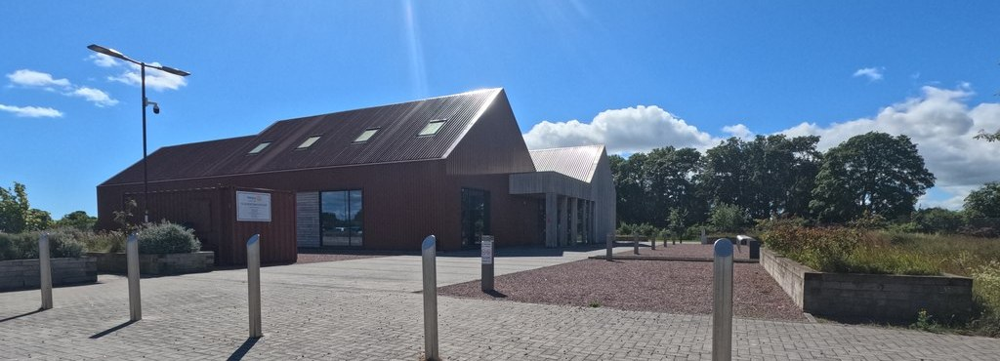

The Tentsmuir Cycle Link survey results are in, and initial findings will be revealed at a **drop-in event on Saturday 14 November at The Larick Centre, Tayport, starting at 10:30am**.

{.rounded-img}

There has been a good numberof responses so far; thank you to everyone who has taken part. We are keen to meet face to face and discuss what happens next, so please come along, have a look at the findings and share your thoughts.

At this stage these are initial results only. The survey will be left open for more feedback, either at the event itself or in the few weeks following it. If you haven't had your say yet, you can still [take the survey](/survey.qmd).

Anyone wishing to remind themselves of the proposal and the suggested alternative route options can view the details on our [map page](/map.qmd), or have a look around the rest of the site.

We hope to see you there!

::: {style="font-size: 0.8em; color: #666;"}
Photo of The Larick Centre by Karl Peet, [CC BY-SA 2.0](https://creativecommons.org/licenses/by-sa/2.0/), via [Geograph](https://www.geograph.org.uk/photo/8345997).
:::
